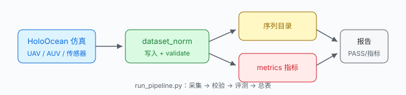

# 空海合成数据集工具

该项目用于管理 **空海一体合成数据集** 的数据规范、评测指标与采集示例（包括空中 UAV、水面 USV、水下 AUV 等多层平台），目标是让他人能按统一格式复现采集，并用同一套口径评测算法精度。

**注意**：本仓库只用于储存 [数据规范](dataset_norm/)、[评测指标](metrics/)、[采集与评测示例](examples/) 及相应说明文档；HoloOcean 引擎与世界包不在本仓库内，需另行安装。



## 仓库说明

| 路径 | 说明 |
|------|------|
| [`dataset_norm/`](dataset_norm/) | 数据规范：目录布局、`SequenceWriter` 落盘、`validate` 校验 |
| [`metrics/`](metrics/) | 评测指标：ATE/RPE、IoU/mIoU、Precision/Recall/F1 |
| [`examples/`](examples/) | 采集与评测脚本，及统一入口 `run_pipeline.py` |
| [`MIMIR-UW.md`](MIMIR-UW.md) | 参考数据集论文笔记 |

## 快速开始

```bash
pip install holoocean numpy pillow
python examples/run_pipeline.py --collect auv --seconds 4
```

`--collect` 可选：`auv`、`camera`、`airsea`、`acoustic`、`sonar`、`nav`、`none`。

单独执行校验或评测：

```bash
python -m dataset_norm.validate <序列目录>
python examples/eval_ate_from_sequence.py --demo
python examples/eval_segmentation_demo.py --demo
python examples/eval_detection_demo.py --demo
```

脚本列表见 [`examples/README.md`](examples/README.md)。

## 数据约定

- 时间戳为纳秒整数，同一通道严格递增
- 位姿为位置（米）与四元数（wxyz）
- 相机 `data.csv` 仅记录时间与文件名，图像存放于 `data/`
- 深度图若保存为 PNG，则为 16 位，像素单位为毫米
- `validate` 失败时退出码为 1

## 设计说明

1. 规范与采集脚本解耦，更换场景不改变目录与字段
2. 数据写入时拒绝非法行，避免脏数据入库
3. 评测仅依赖已落盘序列，无需重新启动仿真
4. 对外统一入口为 `run_pipeline.py`（采集 → 校验 → 评测）

## 参考

- [MIMIR-UW 水下合成数据集](MIMIR-UW.md)
- [HoloOcean](https://github.com/byu-holoocean/holoocean)
- [OpenHUTB/air_water](https://github.com/OpenHUTB/air_water)
